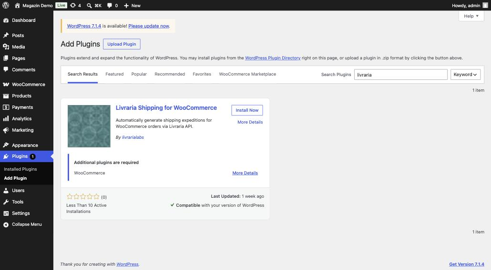
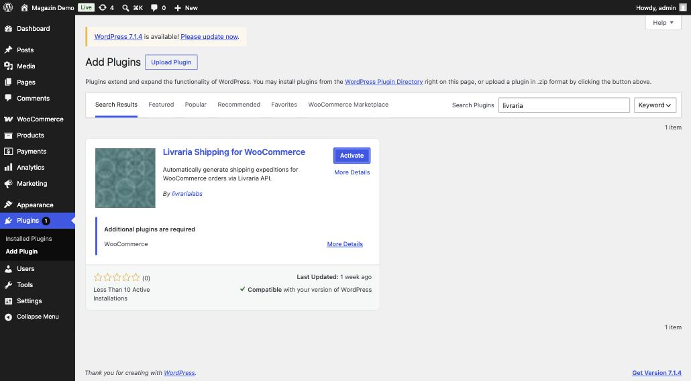
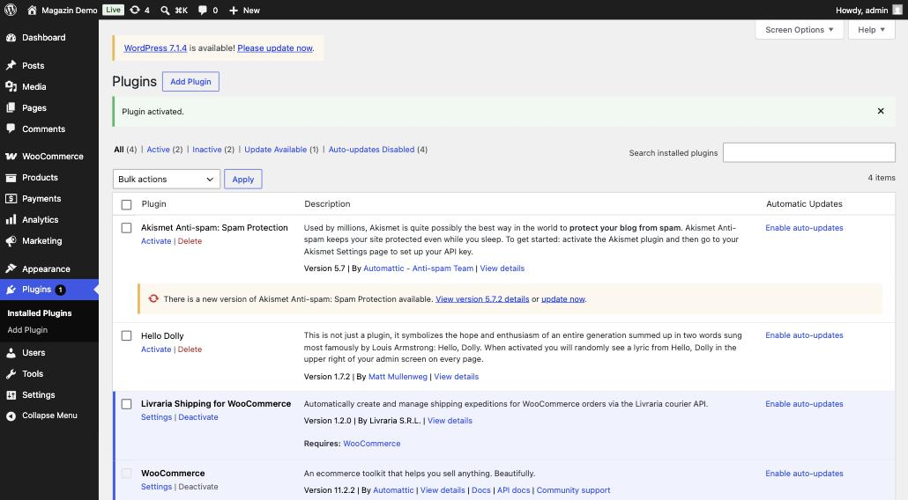
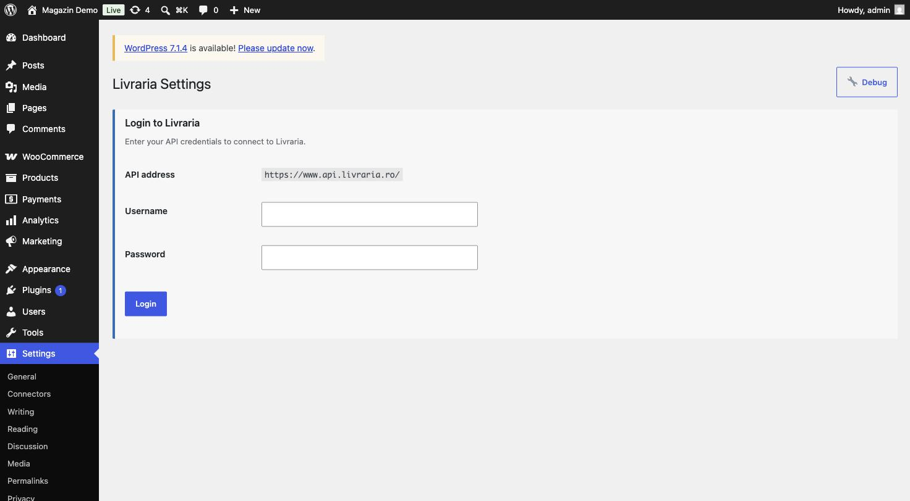
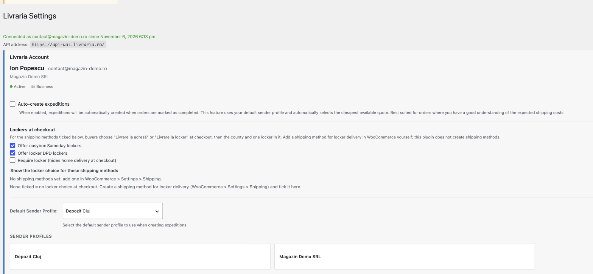
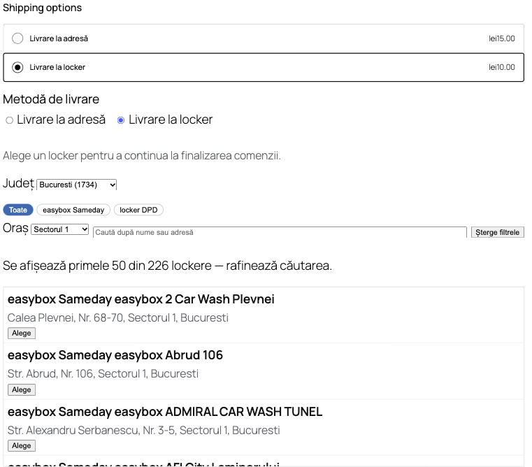
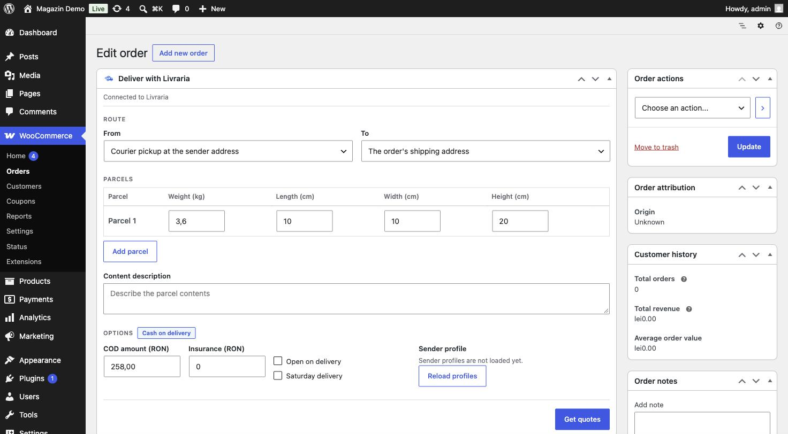
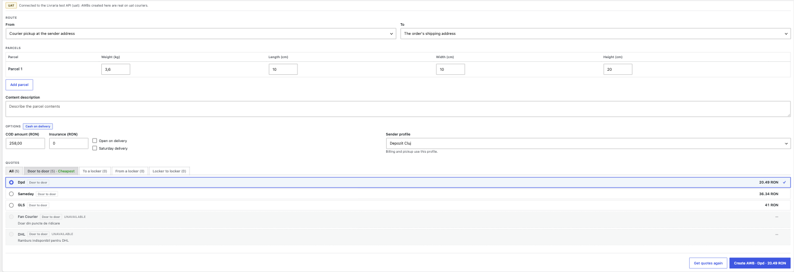
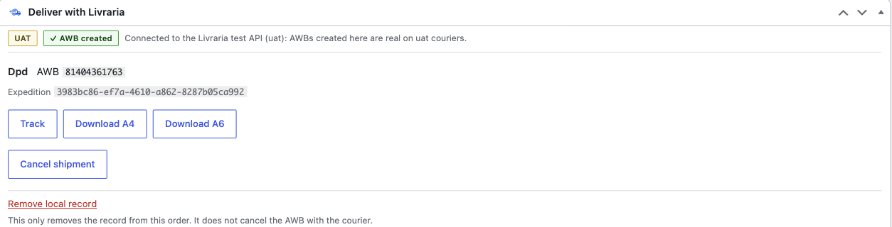
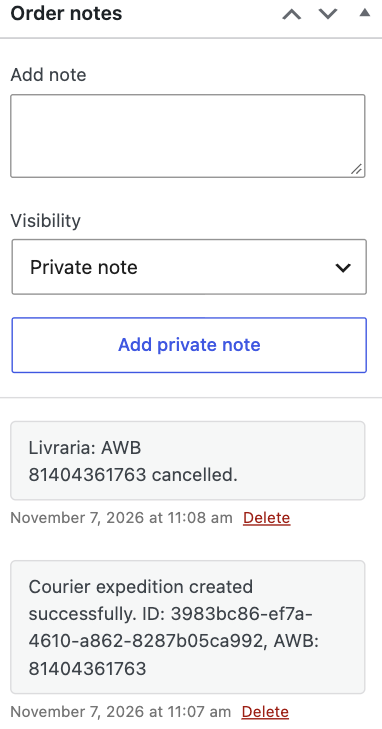

# Livraria pentru WooCommerce — ghid pas cu pas

Creează AWB-uri DPD, Sameday, FAN Courier, GLS sau Curiera direct din comenzile WooCommerce, printr-un singur contract Livraria.

**Versiune ghid:** plugin 1.2.0 („Livraria Shipping for WooCommerce”, pe WordPress.org) · **Timp de configurare:** aproximativ 10 minute.

> Capturile de ecran au fost făcute pe WordPress cu WooCommerce 11.2.2, instalare curată, conectată la un cont Livraria de test. Numele, emailurile, adresele și IBAN-urile din capturi sunt date de exemplu.

## Înainte să începi

| Ai nevoie de | Detalii |
| --- | --- |
| WordPress cu **WooCommerce** activ | Pluginul declară WooCommerce drept cerință. |
| Cont Livraria | Creat pe [livraria.ro](https://livraria.ro), cu detaliile firmei completate. |
| Profil de expeditor | În contul Livraria, **Profiluri expeditor**: adresa de ridicare, datele firmei și IBAN-ul pentru ramburs. Un profil fără IBAN lasă ramburs-ul fără destinație. |
| Cont de tip business | Conturile personale plătesc per colet la checkout; pluginul expediază pe contractul tău și facturează lunar. |

În magazin, setează și:

- **WooCommerce → Settings → General**: țara *România* și moneda *RON*.
- Greutate (kg) și dimensiuni (cm) pe produse, unde se poate. Ce lipsește se completează din valorile implicite ale coletului.

---

## 1. Instalare

1. În WordPress: **Plugins → Add Plugin**.
2. Caută `livraria`.

3. Pe cardul **Livraria Shipping for WooCommerce** (autor *livrarialabs*) apasă **Install Now**.
4. Când butonul devine **Activate**, apasă-l.

5. Pagina **Plugins** confirmă „Plugin activated.” și arată versiunea (1.2.0).

> Preferi arhivă `.zip`? **Plugins → Add Plugin → Upload Plugin**, alegi fișierul și apeși *Install Now*, apoi *Activate*.

---

## 2. Conectează contul Livraria

Deschide setările: **Plugins → Livraria Shipping for WooCommerce → Settings**, sau **Settings → Livraria** (adresa paginii este `options-general.php?page=courier-api-settings`).

1. **API address** este deja completat cu adresa Livraria (`https://www.api.livraria.ro/`).
2. Introdu în **Username** emailul contului Livraria și în **Password** parola.
3. Apasă **Login**.

Dacă nu merge, butonul **Debug** (dreapta sus) deschide două teste:

- **Test Network Connectivity** — dacă pică, hostingul tău blochează conexiunile HTTPS de ieșire. Cere-i furnizorului să permită accesul către `www.api.livraria.ro` pe portul 443.
- **Test Authentication & API Access** — dacă pică, emailul sau parola sunt greșite sau contul Livraria nu a fost confirmat.

După conectare, pagina arată sus „Connected as <emailul tău> since <data>”, apoi contul tău (nume, firmă, starea *Active*, tipul *Business*), comutatorul **Auto-create expeditions**, secțiunea **Lockers at checkout**, **Default Sender Profile** și cardurile profilurilor de expeditor. Butonul roșu **Logout** (dreapta sus) deconectează contul.

> În capturi, numele, emailul, firma și profilurile sunt înlocuite cu date de exemplu. Dacă lucrezi pe un cont de test, pe pagină apare și adresa API de test; pe un cont normal ea este adresa de producție Livraria.

---

## 3. Configurare

După conectare, pagina de setări are următoarele secțiuni.

### 3.1 Profilul de expeditor

Lista **Default Sender Profile** conține profilurile din contul tău Livraria. Alege-l pe cel de unde pleacă coletele acestui magazin; se salvează automat („✓ Saved”). Cardurile de mai jos arată fiecare profil (apasă pe un card pentru detalii).

### 3.2 Crearea automată a AWB-urilor

Comutatorul **Auto-create expeditions** creează AWB-ul singur când o comandă este marcată *Completed*, cu cel mai ieftin curier care poate lua coletul și cu profilul de expeditor implicit. **Acest pas cheltuiește bani.** Începe cu el oprit, expediază câteva comenzi manual și pornește-l abia când prețurile și greutățile par corecte.

- În versiunile de după 1.2.0, AWB-ul se creează în fundal (prin cozile WooCommerce, *Action Scheduler*), oricum ar fi marcată comanda: din listă, în bloc, prin API sau printr-o automatizare.
- În 1.2.0, AWB-ul se creează abia când un administrator deschide comanda după ce a fost marcată *Completed*. O comandă finalizată în bloc sau prin API rămâne fără AWB până o deschide cineva.

Dacă crearea automată eșuează, motivul se scrie ca notă pe comandă și poți crea AWB-ul manual.

### 3.3 Lockere la checkout (opțional)

Secțiunea **Lockers at checkout** le permite cumpărătorilor să aleagă între „Livrare la adresă” și „Livrare la locker”:

1. Bifează curierii pe care îi oferi (*Offer easybox Sameday lockers*, *Offer locker DPD lockers*; ambele sunt bifate implicit). Opțiunea **Require locker (hides home delivery at checkout)** ascunde livrarea la adresă pentru metodele alese.
2. Sub **Show the locker choice for these shipping methods** bifează metodele de livrare WooCommerce la care apare alegerea. Dacă nu ai nicio metodă pentru locker, creează-o la **WooCommerce → Settings → Shipping** și revino.
3. Dacă nu bifezi nicio metodă, alegerea de locker nu apare la checkout.

La checkout, când cumpărătorul alege o metodă bifată, sub metodele de livrare apare **Metodă de livrare** (*Livrare la adresă* / *Livrare la locker*). La locker alege județul, apoi poate filtra după curier (*easybox Sameday*, *locker DPD*), oraș sau nume și apasă **Alege** pe un locker; rândul „Locker ales: …” confirmă alegerea, iar **Schimbă** o reia. Comanda nu poate fi plasată în modul locker fără un locker ales. Alegerea funcționează atât pe checkout-ul cu blocuri (implicit în WooCommerce), cât și pe cel clasic (`[woocommerce_checkout]`).

Pe comandă, panoul **Deliver with Livraria** preia lockerul ales: la *Route → To* apare „The buyer's locker: …”.

> În 1.2.0, pe checkout-ul cu blocuri (implicit în WooCommerce), lockerul ales se putea pierde dacă cumpărătorul modifica adresa după ce l-a ales: comanda se înregistra cu livrare la adresă. Corectat în versiunile de după 1.2.0.

---

## 4. Folosire zilnică: expedierea unei comenzi

1. **WooCommerce → Orders** și deschide comanda.
2. Panoul **Deliver with Livraria** apare în pagina comenzii.

Panoul conține:

- **Route** — *From* (implicit: *Courier pickup at the sender address*) și *To* (implicit: *The order's shipping address*).
- **Parcels** — greutate (kg), lungime, lățime și înălțime (cm). Adaugă colete cu **Add parcel**. Cotarea se face pe aceste valori, deci corectează-le înainte să ceri prețuri.
- **Content description** — ce conține coletul.
- **Options** — **COD amount (RON)** (se completează automat pentru comenzile cu plată la livrare, eticheta *Cash on delivery* apare lângă titlu), **Insurance (RON)**, **Open on delivery**, **Saturday delivery** și **Sender profile** (cu **Reload profiles** dacă lista e goală).

3. Apasă **Get quotes** (durează câteva secunde). Apar ofertele curierilor, cu taburi pe tip de traseu (*All*, *Door to door*, *To a locker*, *From a locker*, *Locker to locker*), cea mai ieftină fiind marcată **Cheapest**. Alege curierul dorit.

   Un curier care nu poate servi acest colet apare gri, cu mesajul **UNAVAILABLE** și motivul (în exemplu: Fan Courier „doar din puncte de ridicare”, DHL „ramburs indisponibil”). Nu este ales niciodată automat.
4. Apasă butonul albastru **Create AWB – <curier> – <preț>**. După creare, panoul arată AWB-ul și permite tipărirea etichetei.

După creare, panoul arată insigna **AWB created**, curierul, numărul AWB și ID-ul expediției, cu butoanele **Track**, **Download A4** și **Download A6** (etichete PDF) și, în versiunile de după 1.2.0, **Cancel shipment**. În istoricul comenzii se adaugă o notă „Courier expedition created successfully” cu ID-ul și AWB-ul.

### Anularea unui AWB

În versiunile de după 1.2.0, panoul are butonul **Cancel shipment**. După confirmare, AWB-ul se anulează la Livraria și, dacă curierul nu a ridicat încă coletul, și la curier. Pe comandă apare nota „Livraria: AWB … cancelled.”, iar panoul revine la formularul de cotare, deci poți expedia comanda din nou.

 Dacă curierul are deja coletul, nu se anulează nimic, AWB-ul rămâne activ și panoul îți spune asta.

În 1.2.0 pluginul **nu poate anula** un AWB: anulează-l din contul tău Livraria, la livraria.ro.

Linkul **Remove local record** șterge doar înregistrarea de pe comandă („It does not cancel the AWB with the courier”). Folosește-l numai când AWB-ul a fost deja anulat în altă parte.

> **Servicii implicite:** lasă *Open on delivery* și *Saturday delivery* debifate, cu excepția cazului în care chiar le vrei. Se taxează suplimentar la fiecare colet care le cere.

---

## 5. Actualizări

Pluginul se actualizează din WordPress, ca oricare altul (**Plugins → Update now**). Reînnoirea sesiunii Livraria se face automat; parola ta nu este stocată. Când sesiunea expiră (în câteva zile), pluginul îți cere să te loghezi din nou.

## 6. Probleme frecvente

| Simptom | Remediu |
| --- | --- |
| Pluginul nu se poate activa | WooCommerce nu e instalat sau e inactiv. Activează-l întâi. |
| „Login” eșuează | Folosește **Debug** (secțiunea 2): verifică întâi conexiunea la rețea, apoi autentificarea. |
| Nu primești prețuri | Verifică adresa de livrare a comenzii (județ, oraș, cod poștal) și telefonul (`07XXXXXXXX`). |
| Greutate lipsă sau greșită | Completează greutatea produselor sau schimbă manual valorile din panou. |
| Alegerea de locker nu apare la checkout | Bifează metoda de livrare potrivită în secțiunea *Lockers at checkout* (3.3). |
| Panoul arată „Sender profiles are not loaded yet.” | Apasă **Reload profiles**; dacă tot nu apar, loghează-te din nou. |
| Comanda marcată *Completed* nu are AWB, deși crearea automată e pornită | Citește notele comenzii: motivul eșecului e scris acolo. În 1.2.0, deschide comanda: AWB-ul se creează abia atunci. Verifică și că ai ales un **Default Sender Profile**. |
